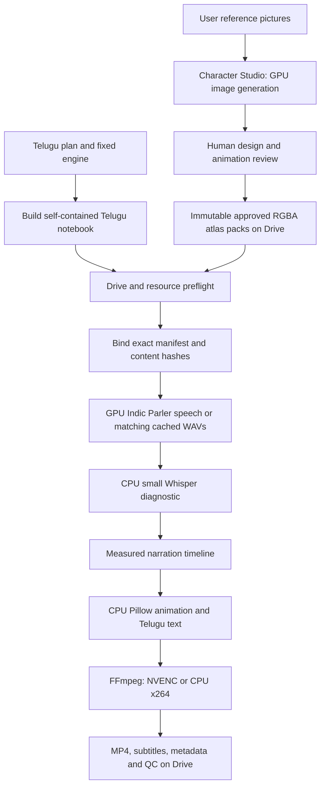
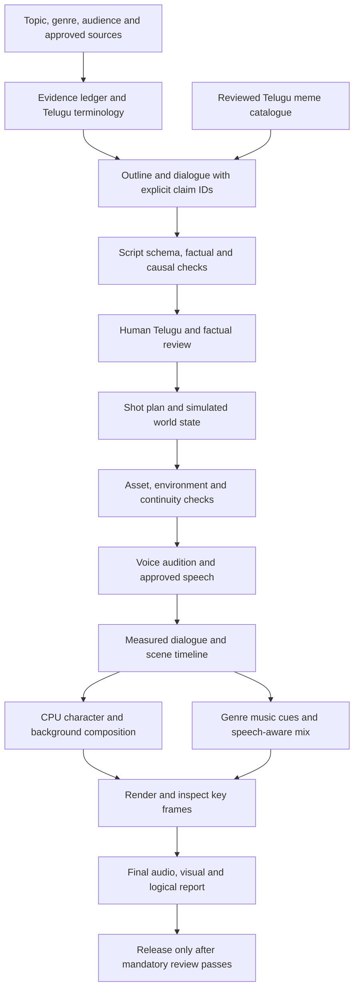

# Current architecture — 2026-11-02

The repository is a Python/Colab video system. The website has been removed. The current cinematic character integration targets **only the Telugu “How 3D movies work” notebook**; all other committed notebooks retain their previous content. The original research architecture is preserved in [history](history/02_ARCHITECTURE_2026-10-11.md), and [EVOLUTION.md](history/EVOLUTION.md) explains the transitions.

## Source and build structure

`colab/engine/lib/` holds the real Python engine modules recovered from the production Storybook notebook, with the cinematic character updates layered into that source. It includes plan/story validation, character atlases, environments, animation, speech workers, music, subtitles and QC. `cinematic/bootstrap.py` reads these files directly; rendering no longer needs to extract its engine from another notebook.

`colab/engine/cells/{shared,cast,narrator,topic}` preserves the original generic templates used by `colab/build.py`. They represent the earlier general pipeline. The latest Telugu notebook had newer embedded cell code; it is now editable separately in `colab/targets/three_d_telugu/cells/`. `colab/build_telugu.py` embeds that target's cells, the canonical engine and `colab/plans/three_d_friends_te_v3_storybook_plan.json` into one portable notebook. `--check` detects source/notebook drift. No repository clone is needed for the ordinary video run.

Other notebooks are historical, self-contained engine snapshots. Moving them does not migrate their embedded runtime. Rebuilding them is a separate change and has deliberately not been done. Use `build_telugu.py`, not the generic builder, for the updated cinematic target.

## Two separate workflows

Character Studio is a one-time, separately reviewed artwork workflow. The approved production pack contains transparent pose images, facial patches, placement information, manifest hashes and provenance. The existing renderer provides movement, speaking mouths, blinking, gestures and camera motion. This is **3D-style illustrated atlas animation**, not a rigged Blender mesh or newly generated 3D geometry on every frame.

The Arjun reference specifies swept brown hair, red jacket, yellow striped shirt, teal trousers and sneakers. Meera's reference specifies auburn ponytail, teal tie, brown eyes and cream floral T-shirt. The shared materials and lighting should follow the dimensional reference. References guide generation; tests cannot establish their visual fidelity. Front-facing conversational poses retain the mouth/blink patches; per-view facial rigs remain a limitation.

## Runtime lifecycle and persistence

1. Mount Drive and check the two approved atlas manifests, cinema/lobby environment folders, RAM, local disk and allocated GPU before installing rendering dependencies.
2. Load the fixed engine. Bind the plan to the actual approved packs on Drive, verifying character identity and file hashes. Missing/provisional artwork fails before speech; there is no replacement with procedural characters.
3. Save the bound plan to a new project, `three_d_friends_te_v3_cinematic`. A different saved plan/hash set causes a stop, preserving the old project. Use a new project name when intentionally changing the story or artwork.
4. Validate the same Telugu script and scenes. Generate missing speech with the existing Prakash/Lalitha Indic Parler voices; cache WAVs and their settings/word-timing sidecars. T4 uses float32 because the existing Parler T5 encoder can overflow in float16; native BF16 is used only on capable GPUs.
5. Measure real audio durations, enforce the 120-second local video limit, then render animated scenes and subtitles. Character asset hashes participate in visual cache keys. Speech models are released before visual rendering.
6. Assemble music/effects and video. Save MP4, subtitle/script files, metadata and QC results. Missing checks and flagged speech still require review; an MP4 file is not evidence of approval.

Completed matching narration, drawn scenes and edited segments persist on Drive. Local scratch, Python packages and model weights can disappear with the Colab runtime. Resume means checking and reusing completed artifacts, not restoring in-memory processes. Partial work in the current operation may need to run again.

## Colab Free resource policy

| Work | Device / limit |
|---|---|
| New Telugu speech | Allocated GPU, at least 12 GiB total / 9 GiB free VRAM before model load |
| Speech diagnostic | Small multilingual Whisper, CPU int8, at most two CPU threads |
| Character motion, image composition, Telugu shaping | CPU Pillow/NumPy, one drawing worker |
| Encoding | Probe NVENC; CPU x264 fallback |
| Output | 1280×720, 24 fps; at most 120 seconds |
| Speech retries | Up to two ordinary attempts per line; extra hero/calmer takes disabled |
| Local session budget | 60 minutes by default, checked between stages/takes and during drawn frames; bounded speech/FFmpeg waits |
| Large visual models | No FLUX, SDXL, Wan or Qwen download in this render target |
| Model storage | Local scratch by default; finished work on Drive |

The budget is a local guard, not a reservation or hard real-time scheduler. An in-flight dependency installation/download or native operation can overrun a boundary; Colab can disconnect sooner. Free GPU allocation and runtime quotas vary. The one-time Character Studio generation has its own resource demands and may require several sessions; the video-render preset does not certify that image-generation workflow's performance.

CPU-only rerendering is explicit: `RENDER_CACHED_AUDIO_ONLY=True` accepts matching narration WAVs and sidecars and never starts the large voice model. Missing/stale narration stops with instructions to allocate a GPU.

## Verification and remaining evidence

The CPU tests cover approval/hash enforcement, reference-driven generation contracts, atlas rendering, immutable versions, notebook source consistency, local budgets, plan binding and scope preservation. Small encoded fixture movies exercise the renderer. These checks do not prove model availability, T4 dependency compatibility, character likeness, final Telugu speech quality or completion within an account's current free quota. No approved cinematic production artwork or completed new Telugu production video is claimed.

See [GOOGLE_COLAB.md](GOOGLE_COLAB.md) for exact Drive inputs and [the character guide](../cinematic/README.md) for review/import steps. See [Save and Publish](CHATGPT_ENVIRONMENT.md) for the separate environment lifecycle.

Speaker-identity model checks (ECAPA) and their extra retakes are omitted from the free-tier target to avoid loading another model alongside Parler. The QC report records that check as UNKNOWN; compare both voices by listening.

---

## Research addendum — Telugu storytelling, consistency, environments and music

**Added 2026-11-02 (India time). Scope: architecture proposal only.** All earlier sections above remain intact. No Colab notebook or video-generation script is changed by this addendum. The controls below are proposed requirements, not checks already implemented or a claim that illogical output can be eliminated automatically. The next script-generation task should use this specification, but no new script is generated here.

### Recommended architecture for this project

Use a **validated story plan, reusable cinematic character/environment assets, narration-first timing, and deterministic composition**. This fits the existing `story`, `validate`, `scene_state`, `telugu_dialogue`, `musiclib`, Storybook and FFmpeg components. Extend those contracts instead of replacing the working renderer with an unconstrained text-to-video system. Existing state/logic checks for generated video must also cover the drawn-story path; having a scene-state module in the repository does not establish that every atlas scene is currently checked.

Separate planning from rendering. Each stage consumes versioned JSON and writes its report and artifacts before advancing. Persist source revisions, model revisions, input hashes, configuration and reviewer decisions. Invalidate dependent outputs when dialogue, assets, timing or evidence changes. An interrupted run should reuse completed matching work; it should never reuse an old approval for changed content.

### Evidence and model choices

These are project-specific recommendations, not a measured universal “best model” ranking. Official GitHub documentation was retrieved during this review; several model-card and Colab FAQ requests were blocked by this environment's network policy. No GPU benchmark or native-speaker evaluation was performed.

| Component | Recommendation | Evidence and unresolved conditions |
|---|---|---|
| Story planning | Retain the existing Qwen-based planner; evaluate a 4B quantized configuration in a separate planning stage | Qwen3's official repository describes multilingual support and open-weight releases. This does not prove natural Telugu or factual accuracy. Verify the exact selected model/quantization license and test Telugu code mixing. |
| Telugu voice baseline | Keep Indic Parler as the known integration baseline; improve text normalization and direction first | Existing repository integrates it with Telugu speakers and a separate environment. Its current Hub card could not be retrieved in this review; existing integration is evidence of implementation, not evidence of naturalness. |
| Telugu voice challenger | Audition AI4Bharat IndicF5, conditional on license and resource approval | Official README explicitly lists Telugu and requires text, reference audio and its transcript. “Near-human” is the author's claim, not a result verified here. The queried repository LICENSE path returned 404 and the Hub card was inaccessible; **do not approve weights for production until exact terms are verified**. |
| Lightweight CPU voice | Do not replace Telugu speech with Piper solely for speed | Piper is an efficient local engine, but its README alone does not establish a suitable licensed Telugu voice. Engine and voice-model licenses must be checked separately. |
| Speech diagnostics | Keep faster-whisper as a diagnostic, with small multilingual CPU inference as the conservative baseline | Its official repository documents CPU int8 inference. ASR disagreement is not proof the Telugu speech is wrong, and agreement is not proof of naturalness. |
| Default soundtrack | CPU procedural score plus a small curated, licensed stem library | Existing NumPy/SciPy/FFmpeg composition provides bounded resource use and exact cue control without a music-model download. |
| Optional generated soundtrack | Evaluate ACE-Step separately, cache approved instrumental stems | Official README describes an 8 GB VRAM optimization and CPU offload, and declares Apache-2.0 for the project. A100 speed claims must not be extrapolated to free T4. Verify weight and dependency terms independently; do not co-load it with TTS. |
| MusicGen | Exclude from the default publishing pipeline | AudioCraft README distinguishes MIT code from CC-BY-NC 4.0 model weights. Open-source code does not make the weights suitable for commercial video generation. |

Google AI Studio is the user's observed voice-quality benchmark. It remains a comparison reference, not a hidden runtime fallback: its speech service is not an open-source local backend. An open model must win a listening test before claiming equivalent quality. If no local candidate meets the quality bar, retain the uncertainty and require voice review rather than quietly switching services.

### Natural Telugu speech and dialogue

Use two text representations per turn: `display_text` for subtitles and `spoken_text` for synthesis. Preserve factual meaning between them. Maintain a pronunciation glossary for names, numbers, units, acronyms and technical terms. Expand “3D” consistently for speech without corrupting the subtitle spelling. Use conversational Telugu with context-appropriate English terms; avoid both literal English-to-Telugu translation and gratuitous slang.

Record the turn's intention, emotion, speaking pace, emphasis and pause hints as metadata. Keep one stable, approved voice identity per character. Render short complete conversational turns, not arbitrary token chunks; preserve breath groups and question/answer cadence. Use pitch or time shifting sparingly because they can reduce naturalness. Normalize loudness without flattening expressive pauses.

Before choosing a voice backend, run a blind native-speaker comparison on roughly 10–12 short samples covering curiosity, neutral explanation, restrained thriller delivery, a humorous reaction, code-mixed terms, names and numbers. Keep the same text and comparable loudness across Parler and eligible challengers. If the user supplies permitted AI Studio reference outputs, compare them under the same conditions. Score intelligibility, pronunciation, conversational flow, speaker consistency and emotional appropriateness separately. Choose only after listening and measuring peak RAM/VRAM and synthesis time on the allocated runtime.

For reference-conditioned speech, require licensed/consented reference audio and an accurate transcript. Do not use film actors' voices, scraped celebrity audio or unlicensed dialogue clips as a voice source. The model's license does not grant rights to a supplied voice recording. Preserve a reference provenance record. A failed quality check may receive one targeted retake; after the configured budget, mark it for review instead of repeatedly generating until resources run out.

### Telugu memes: relevance before frequency

Add a reviewed `meme_catalogue`, rather than asking the model to invent a “trending meme” or scrape movie clips. Each entry should identify its reaction pattern, Telugu phrasing or paraphrase, meaning, suitable contexts, date reviewed, audience constraints, media provenance, permitted usage and fallback original wording. Track whether it is merely an original reaction inspired by a meme pattern or a licensed external media asset. Do not describe a meme as current/trending without recent evidence.

For a 60–120 second video, start with **zero to two** brief meme-inspired reactions, only where they improve understanding or release tension. Thriller/fact explanations usually benefit from fewer jokes than light curiosity videos. Do not put a punchline across a critical explanation or undermine a serious real-world event. For example, a fictional friend may make an original startled reaction to apparent 3D popcorn, followed promptly by the factual correction; the joke must not become evidence that the popcorn physically left the screen.

Each proposed insert needs `meme_id`, `setup_turn`, `reaction_turn`, `reason_for_fit`, `factual_boundary`, `duration_budget` and `rights_status`. Reject unexplained catchphrases, forced dialect, disconnected references, humiliation and jokes that introduce false claims. Quoted claims inside humor still need classification and correction where appropriate. Prefer original Telugu wording, original character animation and synthesized/permitted sound effects. Being recognizable as a meme is not permission to reuse a film clip or soundtrack.

### Strict script and scene gates

Use `PASS`, `FAIL` and `UNKNOWN` with concrete evidence and repair instructions. All mandatory gates must pass before an output is eligible for release. A review render may exist with a clear draft/unapproved status. `UNKNOWN` must never be silently converted to `PASS`. No automated checker can guarantee zero illogical scenes; combine deterministic validation, evidence checks and human review.

| Gate | Required checks and stop conditions |
|---|---|
| Input/schema | Pydantic schema with required fields, bounded lengths, known characters, valid references and enumerated actions. Reject missing IDs, non-finite times, unsupported recipes and excessive scene/repair budgets. |
| Factual grounding | Every factual turn maps to claim IDs and retained source passages. Check names, dates, quantities, units, negation and qualifications. Verify that cited text actually supports the claim; a URL's presence is insufficient. Prefer authoritative primary sources and independent corroboration for disputed/high-impact claims. |
| Script causality | Questions receive answers; explanations precede dependent conclusions; causes precede effects; characters know only what they have learned. Check contradictions across scenes, changing quantities, unsupported leaps, uncorrected misconceptions and unresolved setups. Distinguish fact, hypothesis, analogy and fiction explicitly. |
| Telugu meaning | Compare `spoken_text` and `display_text` for lost numbers, names, negations and altered assertions. NLI/translation checks are advisory unless calibrated for Telugu; require a fluent review where meaning is uncertain. |
| Visual world state | Simulate `state_before → action → state_after` for each shot. Validate actor presence, reachable objects, prop ownership, entrances/exits, handedness, location changes, elapsed time and camera direction. Every action must have satisfied preconditions. |
| Asset feasibility | Verify that the approved atlas actually supports the required pose, view, mouth/expression, glasses and held prop. Unsupported actions require replanning; never pretend an idle image demonstrates the missing action. |
| Cross-modal consistency | Dialogue, action, background, on-screen labels and effects must describe the same event. Arjun cannot “remove glasses” while both successive states still wear them; Meera cannot point to a screen outside the scene; a stereo-view explanation must preserve left/right assignments. |
| Temporal consistency | Use measured speech duration; enforce ordered timestamps and non-overlapping incompatible actions. Keep referent objects visible during their explanation, allow reactions to follow causes and avoid transitions that cut off speech. |
| Render inspection | Inspect opening/closing frames and every state-changing moment for each shot, plus regular samples. Check actual prop visibility, clipping, character overlap, eye/hand alignment, subtitle readability and background continuity. A valid plan alone does not prove the renderer obeyed it. |
| Final audio/video | Check streams, duration, blank frames, clipping, speech masking, subtitle timing and missing narration. Include human Telugu listening and visual/logic sign-off. Retain unresolved issues in the report. |

Use a bounded second-pass critic for semantic mistakes, preferably from separately structured evidence and questions. A second prompt to the same LLM is not independent verification. A visual-language model may assist on a small set of key frames if measured resources permit, but its score must not override deterministic contradictions or replace review. Limit repairs, for example two script revisions and one shot repair, then stop for manual correction. Revalidate every affected downstream stage after a repair.

**Execution/security boundary:** retrieved pages, subtitles, meme text and model outputs are untrusted data. They cannot override instructions or request execution. Validate generated JSON; never execute generated Python/shell. Restrict asset paths to approved roots; reject traversal, archive symlinks and unexpected files. Allowlist asset/model origins, pin revisions, verify hashes and inspect licenses. Audit and pin any necessary `trust_remote_code` implementation before enabling it. Store tokens only in Colab Secrets; redact logs. These checks protect execution; they do not substitute for narrative logic validation.

### Relatable, attractive backgrounds

Build an approved Telugu/Indian setting library: a modern cinema lobby and seating area, apartment living room, study corner, classroom, tea stall, local street, bus stop and science-demo workspace. Choose a setting because it supports the subject and action, not because it looks cinematic in isolation. Avoid treating one regional visual stereotype as universal. Record source/license, location type, lighting, time of day, palette, scale, horizon, character standing zones and prop anchors in each environment manifest.

Use layered foreground/midground/background images, subtle parallax, restrained camera movement, soft lighting and controlled depth cues. Keep the focal region uncluttered and preserve contrast for characters and Telugu subtitles. Reserve safe zones for subtitles, explanatory overlays and gestures. Keep lighting direction, palette and camera axis consistent between adjacent shots. Cinematic illustration must not be presented as authentic footage of a real event.

The default render should reuse approved packs, licensed illustrations/photos or deterministic diagrams. Optional model-generated establishing backgrounds belong in a separate preparation session, with no embedded generated text and with visual review before reuse. Select an image model only after checking exact weight terms and measured T4/RAM requirements; this research does not approve a new image model. If a matching background is unavailable, use a semantically correct simple setting rather than a beautiful but unrelated scene.

### Genre-aware background music

Generate a `music_plan` from the **approved story beats and measured timeline**, not a single genre label for the entire video. Each cue records start/end, genre, mood, intensity, tempo range, instrumentation, harmony/tension, transition, narration density, source/license and deterministic seed. The defaults below are starting creative settings, not scientifically optimal values.

| Video mode | Suggested musical treatment | Avoid |
|---|---|---|
| Thriller | Restrained low pulse, sparse minor/modal harmony, soft drones and gradual tension; roughly 65–95 BPM; brief silence before a reveal | Constant risers, jump scares, vocals, or music implying danger unsupported by the facts |
| Curiosity/mystery | Light mallets/plucks, gentle pulse, unresolved-to-resolved motifs; roughly 80–110 BPM | Repetitive suspense stingers after every question |
| Fact explanation | Minimal neutral texture, soft pads/plucks and stable timing; roughly 70–100 BPM | Dramatic “proof” cues that make uncertain claims sound conclusive |
| Meme/reaction | Brief permitted/original accent or a pause in the score, then return to the established motif | Unlicensed film songs, loud reaction sounds or a cue that masks the next sentence |

Implement the default score with NumPy/SciPy synthesis and FFmpeg mixing, optionally MIDI via `pretty_midi` and a separately licensed soundfont rendered by FluidSynth. Verify licenses for software, soundfonts, samples and stems independently. Reuse a small set of motifs with changes in instrumentation and intensity so the soundtrack develops without sounding randomly regenerated at each cut. Crossfade loops on musical boundaries and align reveals to actual speech timing. These are proposed additions to the existing music module, not code changed in this update.

Begin with music roughly 12–18 dB below speech, then calibrate by listening on phone speakers and headphones; that offset alone does not ensure intelligibility. Use speech-aware sidechain ducking, soft attack/release, and explicit dips beneath technical terms and dense dialogue. Measure the mixed output, not just each input. A provisional delivery target is approximately -16 to -14 LUFS integrated and no higher than -1 dBTP true peak; these are mixing targets, not platform requirements or a guarantee of quality. Avoid unnecessary normalization across intentional silence.

ACE-Step may be tested later for one short instrumental bed per genre in a separate GPU session. Approve and cache the result once; render later videos with cached stems. If it does not fit the allocated resources or licensing cannot be established, use the CPU score/library path. MusicGen's noncommercial weights are not the default alternative.

### Colab Free scheduling and rollout

Keep the current 720p/24 fps output and reusable atlas approach. Planning, voice synthesis and optional asset/music generation run **sequentially**, unloading each large model before the next stage. Render animation, deterministic checks and procedural music on CPU; use NVENC only when the probe succeeds. Do not assume a GPU model, fixed quota or session duration. The existing local 60-minute guard is a project budget, not a Colab entitlement.

Measure available RAM, free VRAM and disk before each model. Use small batches, one render worker, bounded context lengths and at most two ordinary voice attempts. Persist progress after each line/shot. Cache final audio, approved assets, cues and validation artifacts on Drive; default large model weights to disposable local storage unless the user explicitly budgets Drive space. Refuse a model stage that cannot fit; a larger model is not a reason to exhaust the session or quietly reduce validation.

Proposed implementation sequence for a later task:

1. Extend story/claim/state schemas and implement deterministic gates, with positive and deliberately invalid fixtures.
2. Add the curated meme catalogue and Telugu review rubric; verify humor never changes a factual assertion.
3. Run the voice audition and licensing/resource checks before selecting any replacement backend.
4. Add environment manifests and background continuity validation.
5. Add genre cue planning, CPU scoring, ducking and phone-speaker listening tests.
6. Test one short curiosity video and one thriller-styled factual video end to end. Require rejected fixtures for unsupported claims, swapped props, impossible travel, wrong backgrounds, missing poses and obscured speech; successful rendering must not bypass those failures.

Acceptance requires recorded results on the actual allocated Colab runtime and reviewed Telugu output. Until then, all model upgrades and new gates in this addendum remain **proposed**, while the earlier implementation description continues to document what is currently running.

### Research sources and access record

Retrieved official GitHub documents during this review:

- [AI4Bharat IndicF5](https://github.com/AI4Bharat/IndicF5): Telugu support, required reference audio/transcript and example remote-code loading. Exact weight license remains unverified here.
- [Qwen3](https://github.com/QwenLM/Qwen3): model family, multilingual scope and deployment guidance; not a Telugu naturalness benchmark.
- [faster-whisper](https://github.com/SYSTRAN/faster-whisper): CPU int8/GPU inference and benchmark methodology.
- [ACE-Step](https://github.com/ace-step/ACE-Step): project license statement, memory optimization, offload and hardware-specific performance claims.
- [AudioCraft](https://github.com/facebookresearch/audiocraft): explicit distinction between code and model-weight licensing.
- [Piper](https://github.com/OHF-Voice/piper1-gpl): local speech engine; a suitable Telugu voice was not established by this source.

Attempted but blocked by network policy: [Indic Parler model card](https://huggingface.co/ai4bharat/indic-parler-tts), [Qwen3-4B-Instruct-2507 card](https://huggingface.co/Qwen/Qwen3-4B-Instruct-2507), [MusicGen-small card](https://huggingface.co/facebook/musicgen-small), and [Colab FAQ](https://research.google.com/colaboratory/faq.html). Recheck their live terms and limitations before implementation. Documentation fetched from a repository's default branch can change; pin the selected implementation/model revisions in the eventual build. No claim in this addendum relies on an unperformed T4 benchmark.

---

## Retention audit and improvement plan — 2026-11-02

**Scope:** documentation-only review of the existing videos and current v4 plan. No script, notebook, renderer or asset is changed by this section. Recommendations below are hypotheses to test, not promises that every viewer will watch to the end.

### What was actually reviewed

- Current `colab/stories/three_d_friends_te_v4/script.md`, `story.json` and its compiled production plan: six scenes, 19 dialogue turns and 22 visual segments. Three of those segments are explanatory diagrams. Segment counts do **not** measure screen time; actual duration depends on synthesized speech.
- Visually inspected `colab/reports/storybook/E_contact_sheet.jpg`. It shows historical procedural character artwork, repeated cinema seating compositions, two diagram treatments and lobby/closing shots. It is not a preview of approved cinematic-v2 artwork or the finished v4 video. A contact sheet cannot establish motion quality or audio naturalness.
- Historical `E_qc_report.json`: expected duration 107.54 seconds, overall approval false, with narration correctness, human holistic review and character-art approval unresolved. These are old evidence, not measured v4 results.
- Current target settings and visual start positions. The code supports technically valid output, but its passing tests do not measure engagement, comprehension or Telugu delivery quality.

There is no current audience-retention curve, traffic-source breakdown, finished v4 production render or native-speaker voice rating available in this review. The user's report that AI Studio sounds more natural is meaningful qualitative feedback, but not a controlled comparison. Claims about exact audience drop-off times would therefore be speculation.

### Main drawbacks, with evidence and practical remedies

| Priority | Observed evidence | Likely effect to test | Recommended change |
|---|---|---|---|
| P0 | In sc03, `eye_views` starts at turn 0 / fraction 0.3, then `v3` switches to Arjun at turn 1. Meera's brain/depth explanation is turn 2. | Viewers hear the central mechanism while the explanatory picture is no longer visible. | Keep the eye diagram through the explanation; progressively highlight the two views and their differences. Use Arjun's reaction briefly after the mechanism lands, or as a small inset only if legible. |
| P0 | In sc04, `projector_glasses` starts during turn 1, then cuts to a reaction at turn 2 and Meera's closeup at turn 3, when she explains the filters. | The hardest idea has to be understood from speech alone. | Keep the channel/filter diagram visible through turn 3. Highlight one image-to-eye path at a time, using labels as well as color; camera left/right must not reverse the explanation. |
| P0 | Naturalness remains unverified and the user reports the local voice sounds worse than AI Studio. | Stilted rhythm can make even a good script feel narrated rather than conversational. | Prioritize blind Telugu listening auditions, pronunciation and pause repair before adding heavier visuals. Preserve one identity per speaker and avoid exaggerated pitch manipulation. |
| P1 | sc01 contains a startled reaction, a joke and only then the main question. | The premise may take too long to become clear, particularly when pauses or TTS timing stretch the exchange. | Show the surprising screen event immediately and state the mystery in the first exchange. Keep the joke only if the measured opening remains clear and brisk. |
| P1 | sc02 introduces the one-eye test and the monocular-depth qualification before the main two-view mechanism. | A valuable nuance may distract from the central question before viewers have a simple mental model. | Test a version that first establishes two slightly different views, then uses the one-eye test as confirmation. Preserve the qualification that one eye still gives depth cues; do not simplify it into a false claim. |
| P1 | sc05 says “అర్థమైంది కదా! ఇప్పుడు సినిమా చూద్దామా?” before sc06 adds three more turns. | It signals completion early and can make the final exchange feel optional. | Remove the premature goodbye in a future script edit. Place one short comprehension/payoff moment immediately before the closing visual callback, then finish. |
| P1 | The historical sheet repeats similar seated character compositions; v4 intentionally stays in one cinema. | The location is coherent, but repeated composition without new information may feel static. | Retain the location and vary the *purpose* of shots: screen event, reaction, demonstration, diagram, payoff. Do not introduce unrelated locations just to create novelty. |
| P1 | v4 safely removes spills, handoffs and changing locations, but many visual descriptions now repeat a generic same-seated-friends instruction. | Continuity is improved, yet the descriptions offer little specific direction about what each shot teaches. | Give each shot one explicit information goal and a visible change that supports it. Avoid merely repeating dialogue in visual metadata. |
| P2 | Historical diagrams contain small labels and the contact sheet shows subtitles competing with dense seat patterns. | Phone viewers may have difficulty separating the important information from decoration. This requires full-size testing; the thumbnail sheet is not conclusive. | Review full-resolution output at phone size. Enlarge key labels, simplify diagram regions and keep the subtitle area quiet with a consistent contrast treatment. |
| P2 | The current procedural score follows broad scene moods; precise speech-aligned musical cues are not implemented. | Music may remain generic or miss the intended reveal. No listening assessment was performed here. | Start with subtle curiosity music, lower it under explanation, and reserve one change or brief silence for the real reveal. Do not add suspense stingers to every line. |
| P2 | The hook promises a “pop-out” experience, but the end mainly repeats Arjun's duck. | A joke alone may not demonstrate that the viewer understood the original mystery. | Before the callback, resolve the promise explicitly: the image stays on the screen; two eye-specific views contribute to perceived depth. Keep that final explanation concise and sourced. |

The highest-value change is **better timing between narration and evidence**, not more character-detail generation. Attractive backgrounds help presentation, but cannot compensate for a diagram disappearing during the explanation.

### Research principles and their limits

These principles draw on established educational-video and curiosity research. Attempts to retrieve the official articles and YouTube help pages during this session were blocked by the network policy, so their current full text and wording were not independently rechecked here. Treat the references below as a reading trail; this is not a fresh systematic review or a quantified prediction for Telugu YouTube videos.

1. **Make the information gap specific.** Curiosity research links the desire to know an answer with attention and memory in controlled tasks. Use a question viewers can understand and care about, then deliver the answer. This does not justify repeatedly withholding a simple fact or inventing danger.
2. **Signal what matters.** Research on educational video and cognitive load supports reducing irrelevant material, organizing information into manageable segments, and guiding attention to the relevant visual. Progressive diagram highlights are a better fit here than constant unrelated cuts.
3. **Make viewers think briefly.** A short prediction or mental experiment can make an explanation active. Ask a concrete question, allow a small pause, then demonstrate and answer. Do not force a long quiz into a short video.
4. **Use duration efficiently.** Research on MOOC viewing found associations between production choices, length and engagement. Those observational results do not establish a universal ideal duration or prove that every short entertainment video should follow the same pacing.
5. **Read retention curves as evidence, not verdicts.** YouTube's retention tools distinguish parts where viewers continue, skip, leave or revisit. A spike can indicate interest, sharing or confusion; a dip can reflect skipping as well as leaving. Inspect the relevant frames/audio before choosing a remedy.

There is no defensible universal “eight-second attention span,” mandatory cut every two seconds, guaranteed retention percentage, or promise that a particular meme will prevent drop-off. Avoid those rules in future automated prompts.

### Suggested attention arc for this 3D explainer

This is a future editing blueprint, not the current measured timeline. The suggested windows are an initial experiment for a roughly 60–90 second cut; narration and comprehension decide the final timings.

| Approximate position | Viewer question | What earns continued attention |
|---|---|---|
| First 0–5 seconds | “Why did that look as if it came toward him?” | Show the startled reaction and screen cause together. Establish the concrete mystery without a logo sequence or lengthy introduction. |
| About 5–15 seconds | “Is the picture moving, or is my perception changing?” | Offer a simple prediction/observation with an immediate partial answer. Make it clear the illustration is not a physical object leaving the screen. |
| About 15–35 seconds | “What do two eyes add?” | Keep the two-view diagram visible, highlighting one eye/view at a time and then the difference. A brief character reaction follows the useful information. |
| About 35–55 seconds | “How does one screen send different views to each eye?” | Introduce the polarized-system qualifier, then retain the glasses diagram through the filter explanation. Avoid a lecture on polarization physics beyond this video's scope. |
| Final section | “Can I now explain the trick?” | Resolve the original mystery, briefly retain the one-eye-depth qualification if not already established, and pay off the opening with one short visual callback. End immediately after it. |

Do not promise that viewers can experience stereoscopic depth from an ordinary 2D phone upload. Label screen diagrams as explanations, not a functional 3D display. The existing one-eye test is a fictional cinema observation; do not instruct viewers to reproduce that exact cinema effect on a normal phone. If a future version proposes a finger/alternating-eye demonstration, first ensure the action can be represented accurately and does not require unsupported atlas poses.

### New planning contract for retention — proposed, not implemented

Extend each future story beat with the following editorial fields, separate from the renderer's actual executable schema:

- `viewer_question`: the specific uncertainty this beat addresses.
- `new_information`: the new fact, observation or consequence introduced here.
- `evidence_on_screen`: the diagram/object/state that must remain visible during the relevant words.
- `spoken_span`: turn IDs, later resolved to measured audio timestamps.
- `payoff_of`: the earlier question or setup being answered; required before closing an information gap.
- `attention_change`: a meaningful change such as a revealed diagram channel, reaction, brief silence or corrected prediction. “Random zoom” is not a sufficient reason.
- `comprehension_risk`: difficult terminology, competing visuals or a likely misconception, with a mitigation.
- `review_status`: evidence of factual, timing and human review rather than a model's engagement score.

Add an editorial report that detects unanswered setup questions, repeated explanations, early closing phrases, diagrams missing during their referenced speech, and stretches without new information. Thresholds should be tuned using actual recordings; automatic warnings should not force a cut into every quiet or important moment. Review all suggested edits against the existing causality, factual and asset-feasibility gates.

Maintain a clear distinction between **release correctness** and **engagement hypotheses**. Unsupported claims and impossible actions block release. A suggested shorter hook or faster transition is an editorial experiment, not a scientific correctness rule. An LLM-generated “retention score” must not be presented as a measured viewer outcome.

### Voice, humor, visuals and sound as one edit

- **Dialogue:** give Arjun a plausible thought or prediction rather than using every turn as a cue for Meera's next lecture. Reduce repeated confirmations when the animation already makes the answer clear. Preserve enough pause for comprehension, and trim only accidental dead air.
- **Humor:** keep the existing original opening reaction and ending callback if listening confirms they work. Do not add more memes solely to increase stimulation. Place humor after comprehension or as a setup, never across an important claim or diagram label.
- **Visual rhythm:** use wide shots for context, closeups for genuine reactions and diagrams for mechanisms. Stay on the useful diagram as long as needed. An approved character atlas does not require the character to fill every frame.
- **Backgrounds:** the cinema is relevant to this topic. Improve focal hierarchy and visual contrast inside that environment before spending GPU time on additional scenery. Beautiful scenery should support the question, not compete with it.
- **Subtitles:** retain accurate Telugu shaping, natural phrase boundaries and clear speaker differentiation. Avoid simultaneous dense captions, labels and decorative motion. Check text on a phone, not only a desktop preview.
- **Music:** use mild mystery rather than horror for this science explanation. Increase tension only while a genuine question is open; resolve it when the explanation resolves. A short silence may work better than another sound effect. Always listen for masking of consonants and technical words.

### How to measure whether the changes work

Before publishing, test a small rough cut with several Telugu-speaking viewers who did not help write it. Ask them to mark confusing/slow moments and explain the answer in their own words. A small convenience sample is directional feedback, not statistical proof. Include phone viewing and ordinary speakers or earphones. Check that viewers understand the distinction between physical movement and perceived depth, and the limited scope of the polarized-system explanation.

Once real audience data exist, record:

- Video length and format (Shorts versus standard video), publish date, language, topic, traffic sources and sample size.
- Average view duration, average percentage viewed, retention at available comparable positions, and end-of-video retention. Report uncertainty for small samples.
- The exact dialogue, visuals and music at large dips or spikes, plus whether the pattern persists with more viewers.
- Title/thumbnail impressions and click-through rate where applicable. For Shorts, use the relevant feed engagement metrics; do not compare them directly with standard-video thumbnail CTR.
- Comprehension or satisfaction feedback. Completion without understanding is not success for an educational video.

Test one major variable at a time: first hook clarity, then diagram timing, then voice delivery, then optional music/humor variations. Compare similar duration/topic/traffic cohorts; differences between two unrelated uploads are not causal evidence. Keep a version log linking each edit to its hypothesis and outcome. A shorter cut can mechanically improve completion while reducing useful viewing time, so assess both retention and delivery of the explanation.

### Practical priority order under Colab Free

1. Fix diagram-to-speech alignment and eliminate the premature ending cue. These are low-cost editing changes with strong relevance to the observed plan.
2. Listen to the opening and hardest explanatory turns; repair pronunciation and rhythm. Run the previously specified backend audition before replacing the TTS model.
3. Tighten the first exchange and move nuance to the point where it helps understanding. Preserve factual qualifications.
4. Verify phone-size captions/diagrams and improve background contrast without generating new assets.
5. Tune the score around the real reveal, then test whether the single joke/callback improves or disrupts the experience.
6. Use audience feedback to decide whether additional animation or model generation is worthwhile. Do not exhaust a free session rendering unused alternate backgrounds or many speculative takes.

For edit experiments, reuse approved art and narration caches, render short low-resolution previews of the changed section, and produce the final 720p cut only after review. Low-resolution previews assess timing/composition; verify text legibility and audio quality again at delivery resolution. Keep model stages sequential and respect the existing resource limits.

### References and access limitations

- YouTube Help, [Measure key moments for audience retention](https://support.google.com/youtube/answer/9314415?hl=en). Official analytics guidance; retrieval blocked in this session.
- YouTube Help, [Understand your YouTube video reach](https://support.google.com/youtube/answer/9314486?hl=en). Context for separating packaging/reach from in-video retention; retrieval blocked.
- Brame, C. J. (2016), [Effective Educational Videos: Principles and Guidelines for Maximizing Student Learning from Video Content](https://pmc.ncbi.nlm.nih.gov/articles/PMC5132380/). Review of cognitive load, engagement and active learning; retrieval blocked. Educational design guidance is not a guaranteed social-video retention formula.
- Guo, P. J., Kim, J., and Rubin, R. (2014), [How Video Production Affects Student Engagement: An Empirical Study of MOOC Videos](https://groups.csail.mit.edu/uid/other-pubs/las2014-pguo-engagement.pdf). Observational educational-video research; retrieval blocked. Do not transfer effect sizes or length recommendations directly to this audience.
- Gruber, M. J., Gelman, B. D., and Ranganath, C. (2014), [States of Curiosity Modulate Hippocampus-Dependent Learning via the Dopaminergic Circuit](https://pmc.ncbi.nlm.nih.gov/articles/PMC4252494/). Controlled learning/memory research; retrieval blocked. It supports investigating curiosity, not a claim that a cliffhanger guarantees watch time.

**Conclusion for the current project:** the most concrete weaknesses are explanation/visual misalignment, an opening that delays its main question, an early ending signal, and unverified speech naturalness. The historical material also suggests repetitive framing and a need for phone-legibility review. Actual audience losses remain unmeasured. Improve the clarity and payoff of the current story before adding more models or more memes.
