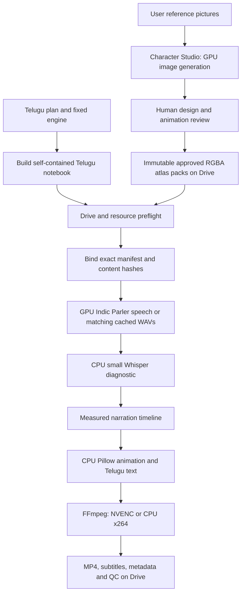

# Current architecture — 2026-11-02

The repository is a Python/Colab video system. The website has been removed. The current cinematic character integration targets **only the Telugu “How 3D movies work” notebook**; all other committed notebooks retain their previous content. The original research architecture is preserved in [history](history/02_ARCHITECTURE_2026-10-11.md), and [EVOLUTION.md](history/EVOLUTION.md) explains the transitions.

## Source and build structure

`colab/engine/lib/` holds the real Python engine modules recovered from the production Storybook notebook, with the cinematic character updates layered into that source. It includes plan/story validation, character atlases, environments, animation, speech workers, music, subtitles and QC. `cinematic/bootstrap.py` reads these files directly; rendering no longer needs to extract its engine from another notebook.

`colab/engine/cells/{shared,cast,narrator,topic}` preserves the original generic templates used by `colab/build.py`. They represent the earlier general pipeline. The latest Telugu notebook had newer embedded cell code; it is now editable separately in `colab/targets/three_d_telugu/cells/`. `colab/build_telugu.py` embeds that target's cells, the canonical engine and `colab/plans/three_d_friends_te_v3_storybook_plan.json` into one portable notebook. `--check` detects source/notebook drift. No repository clone is needed for the ordinary video run.

Other notebooks are historical, self-contained engine snapshots. Moving them does not migrate their embedded runtime. Rebuilding them is a separate change and has deliberately not been done. Use `build_telugu.py`, not the generic builder, for the updated cinematic target.

## Two separate workflows

Character Studio is a one-time, separately reviewed artwork workflow. The approved production pack contains transparent pose images, facial patches, placement information, manifest hashes and provenance. The existing renderer provides movement, speaking mouths, blinking, gestures and camera motion. This is **3D-style illustrated atlas animation**, not a rigged Blender mesh or newly generated 3D geometry on every frame.

The Arjun reference specifies swept brown hair, red jacket, yellow striped shirt, teal trousers and sneakers. Meera's reference specifies auburn ponytail, teal tie, brown eyes and cream floral T-shirt. The shared materials and lighting should follow the dimensional reference. References guide generation; tests cannot establish their visual fidelity. Front-facing conversational poses retain the mouth/blink patches; per-view facial rigs remain a limitation.

## Runtime lifecycle and persistence

1. Mount Drive and check the two approved atlas manifests, cinema/lobby environment folders, RAM, local disk and allocated GPU before installing rendering dependencies.
2. Load the fixed engine. Bind the plan to the actual approved packs on Drive, verifying character identity and file hashes. Missing/provisional artwork fails before speech; there is no replacement with procedural characters.
3. Save the bound plan to a new project, `three_d_friends_te_v3_cinematic`. A different saved plan/hash set causes a stop, preserving the old project. Use a new project name when intentionally changing the story or artwork.
4. Validate the same Telugu script and scenes. Generate missing speech with the existing Prakash/Lalitha Indic Parler voices; cache WAVs and their settings/word-timing sidecars. T4 uses float32 because the existing Parler T5 encoder can overflow in float16; native BF16 is used only on capable GPUs.
5. Measure real audio durations, enforce the 120-second local video limit, then render animated scenes and subtitles. Character asset hashes participate in visual cache keys. Speech models are released before visual rendering.
6. Assemble music/effects and video. Save MP4, subtitle/script files, metadata and QC results. Missing checks and flagged speech still require review; an MP4 file is not evidence of approval.

Completed matching narration, drawn scenes and edited segments persist on Drive. Local scratch, Python packages and model weights can disappear with the Colab runtime. Resume means checking and reusing completed artifacts, not restoring in-memory processes. Partial work in the current operation may need to run again.

## Colab Free resource policy

| Work | Device / limit |
|---|---|
| New Telugu speech | Allocated GPU, at least 12 GiB total / 9 GiB free VRAM before model load |
| Speech diagnostic | Small multilingual Whisper, CPU int8, at most two CPU threads |
| Character motion, image composition, Telugu shaping | CPU Pillow/NumPy, one drawing worker |
| Encoding | Probe NVENC; CPU x264 fallback |
| Output | 1280×720, 24 fps; at most 120 seconds |
| Speech retries | Up to two ordinary attempts per line; extra hero/calmer takes disabled |
| Local session budget | 60 minutes by default, checked between stages/takes and during drawn frames; bounded speech/FFmpeg waits |
| Large visual models | No FLUX, SDXL, Wan or Qwen download in this render target |
| Model storage | Local scratch by default; finished work on Drive |

The budget is a local guard, not a reservation or hard real-time scheduler. An in-flight dependency installation/download or native operation can overrun a boundary; Colab can disconnect sooner. Free GPU allocation and runtime quotas vary. The one-time Character Studio generation has its own resource demands and may require several sessions; the video-render preset does not certify that image-generation workflow's performance.

CPU-only rerendering is explicit: `RENDER_CACHED_AUDIO_ONLY=True` accepts matching narration WAVs and sidecars and never starts the large voice model. Missing/stale narration stops with instructions to allocate a GPU.

## Verification and remaining evidence

The CPU tests cover approval/hash enforcement, reference-driven generation contracts, atlas rendering, immutable versions, notebook source consistency, local budgets, plan binding and scope preservation. Small encoded fixture movies exercise the renderer. These checks do not prove model availability, T4 dependency compatibility, character likeness, final Telugu speech quality or completion within an account's current free quota. No approved cinematic production artwork or completed new Telugu production video is claimed.

See [GOOGLE_COLAB.md](GOOGLE_COLAB.md) for exact Drive inputs and [the character guide](../cinematic/README.md) for review/import steps. See [Save and Publish](CHATGPT_ENVIRONMENT.md) for the separate environment lifecycle.

Speaker-identity model checks (ECAPA) and their extra retakes are omitted from the free-tier target to avoid loading another model alongside Parler. The QC report records that check as UNKNOWN; compare both voices by listening.
